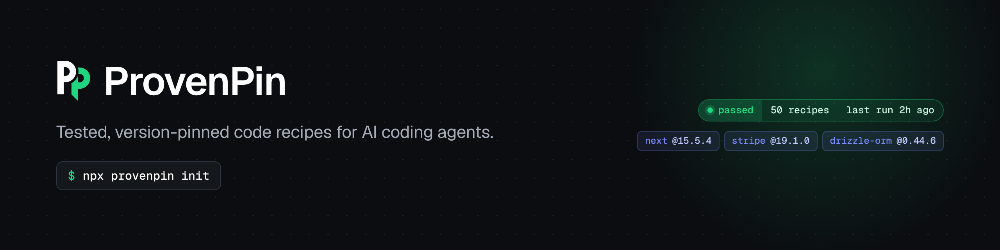

<p align="center"></p>

# ProvenPin

Tested, version-pinned, multi-library code recipes for AI coding agents, served over MCP.

Every recipe pins exact versions, runs its own tests in a clean environment, and carries a receipt with the time it last passed. Recipes are re-tested automatically when any of their libraries ships a new release. The MCP server only serves recipes that are currently passing.

## Install

ProvenPin is a hosted MCP server. No API key, no signup.

Endpoint: `https://mcp.provenpin.com/mcp`

**Claude Code**
```
claude mcp add --transport http provenpin https://mcp.provenpin.com/mcp
```

**Cursor** (`~/.cursor/mcp.json`)
```json
{ "mcpServers": { "provenpin": { "url": "https://mcp.provenpin.com/mcp" } } }
```

**VS Code** (`.vscode/mcp.json`)
```json
{ "servers": { "provenpin": { "type": "http", "url": "https://mcp.provenpin.com/mcp" } } }
```

**Windsurf** (`~/.codeium/windsurf/mcp_config.json`)
```json
{ "mcpServers": { "provenpin": { "serverUrl": "https://mcp.provenpin.com/mcp" } } }
```

**Cline** (MCP settings)
```json
{ "mcpServers": { "provenpin": { "type": "streamableHttp", "url": "https://mcp.provenpin.com/mcp" } } }
```

Then ask your agent something like "find a tested recipe for a Next.js Stripe webhook".

## MCP tools

| tool | what it does |
|---|---|
| `search_recipes` | find passing recipes by plain words, stack filter or language |
| `get_recipe` | full files, pinned versions, setup and test commands, and the receipt |
| `list_stacks` | libraries that have tested recipes, with counts |

```
recipes/   one folder per recipe (see SPEC.md)
runner/    validate, run tests in isolation, write receipts, release check, build index
receipts/  real test receipts (JSON)
index/     built index.json served by the MCP server
server/    MCP server (TypeScript, Cloudflare Workers, local dev mode)
.github/   CI: matrix per recipe, scheduled + on demand, release-triggered re-tests
```

## Run locally (Node 22+, Python 3.13 and uv for Python recipes)

```
npm install
npm run validate                 # check manifests and pins
npm run test:recipes             # run every recipe, write receipts
node runner/run.mjs hono-zod-validator   # run one
npm run affected                 # recipes with newer upstream releases
npm run build:index              # build index/index.json
npm test                         # runner unit tests

cd server && npm install
npm test                         # MCP server unit tests
npm run dev                      # http://localhost:8787/mcp
```

Connect a client to the local server, for example in Claude Code:

```
claude mcp add --transport http provenpin http://localhost:8787/mcp
```

Pro API keys (groundwork, off by default): the free tier needs no key. When `PROVENPIN_PRO_ENABLED` is `"true"`, a valid `Authorization: Bearer <key>` header marks the caller as Pro. Keys come from the `PROVENPIN_API_KEYS` secret or the `PRO_KEYS` KV namespace (entries `key:<sha256 of key>`). Usage events record only the tier (`free` or `pro`), never the key.

## Receipts feed

`https://mcp.provenpin.com/receipts.json` (also `index/receipts.json`, rebuilt with the index) lists every recipe:

| Field | Meaning |
| --- | --- |
| `id`, `language` | Recipe id and language |
| `pinned` | Exact versions the recipe was tested with |
| `runtime` | Runtime of the last test run, for example `node v22.23.3` |
| `status` | `passed`, `failed`, `setup_failed`, `invalid`, `stale` (code changed since the last run) or `untested` |
| `last_passed_at` | When the tests last passed on the pinned versions (UTC) |
| `run_url` | GitHub Actions run that produced the current receipt |
| `staleness` | Weekly re-test with stack libraries bumped to latest: `status` (`current`, `passes_on_latest`, `breaks_on_latest`, `error` or `unchecked`), `checked_at`, `latest` versions tried, `run_url` |

The staleness check (`.github/workflows/staleness.yml`) runs weekly in a temp copy. It never edits a recipe or its receipt, and it lists recipes that break on latest in one GitHub issue.

## Deploy your own

1. Push this repo to a GitHub account for the brand.
2. In Cloudflare: create an API token with "Edit Cloudflare Workers", add `CLOUDFLARE_API_TOKEN` and `CLOUDFLARE_ACCOUNT_ID` as repo secrets, set repo variable `DEPLOY_ENABLED=true`.
3. `cd server && npx wrangler deploy` (or let CI do it), then route `mcp.<domain>` to the worker.

## License

MIT. See [LICENSE](LICENSE).
